# Mermaid Diagram Syntax Reference

Polo AI renders Mermaid diagrams natively as beautiful themed SVGs. Use this reference for syntax details.

## Optional YAML Frontmatter

Mermaid code blocks may start with YAML frontmatter. Polo AI accepts the frontmatter for compatibility and renders the diagram syntax that follows it. For visible chart titles, prefer diagram-level title syntax (for example, `title "Monthly Revenue"` in `xychart-beta`).

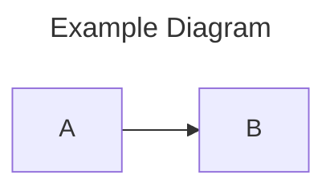

## Flowcharts

**Header:** `graph LR` (left-right) or `graph TD` (top-down)
**Directions:** LR, RL, TD, TB, BT — pick by diagram size (see Best Practices)

### Node Shapes

| Syntax | Shape |
|--------|-------|
| `A[text]` | Rectangle |
| `A(text)` | Rounded rectangle |
| `A{text}` | Diamond (decision) |
| `A([text])` | Stadium |
| `A((text))` | Circle |
| `A[[text]]` | Subroutine |
| `A[(text)]` | Cylinder (database) |
| `A{{text}}` | Hexagon |
| `A>text]` | Asymmetric flag |
| `A[/text\]` | Trapezoid |
| `A[\text/]` | Trapezoid (alt) |
| `A(((text)))` | Double circle |

### Arrow Types

| Syntax | Style |
|--------|-------|
| `-->` | Solid arrow |
| `---` | Solid line (no arrow) |
| `-.->` | Dotted arrow |
| `-.-` | Dotted line |
| `==>` | Thick arrow |
| `===` | Thick line |
| `<-->` | Bidirectional solid |
| `<-.->` | Bidirectional dotted |
| `<==>` | Bidirectional thick |

### Edge Labels

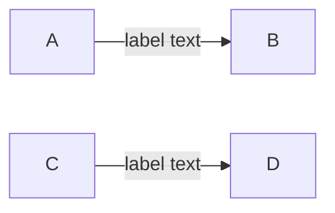

### Subgraphs

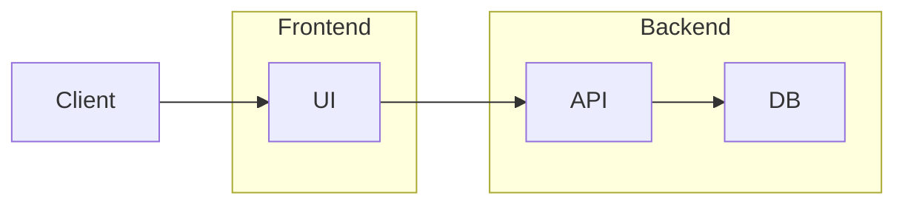

### Subgraph with ID

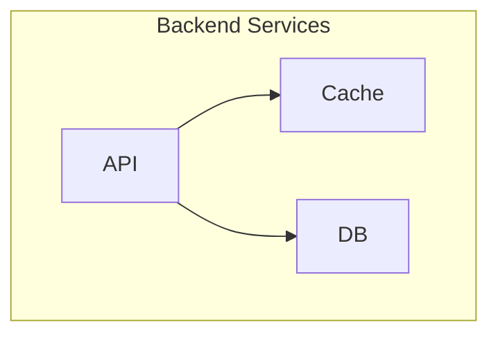

### Styling

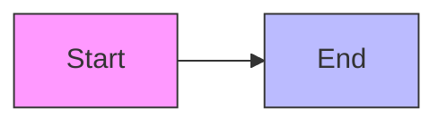

### Chained Edges

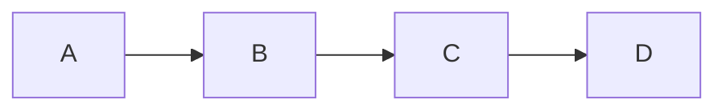

### Parallel Links

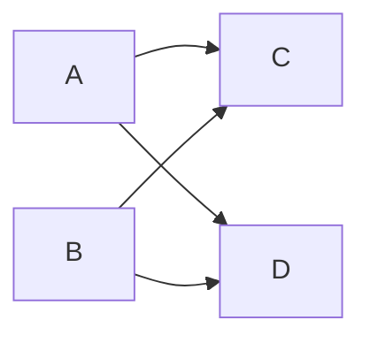

## State Diagrams

**Header:** `stateDiagram-v2`

### Basic States

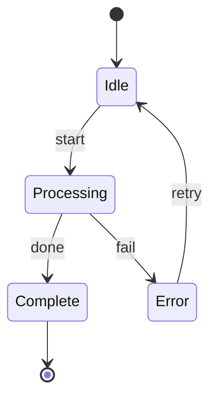

### State Descriptions

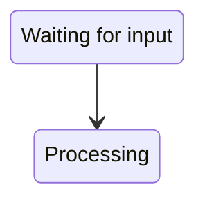

### Composite States

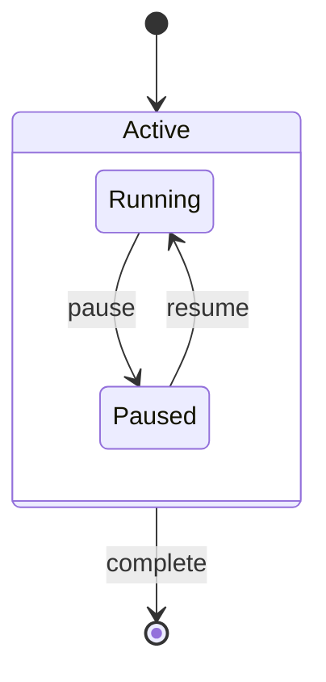

### Direction Override

```mermaid
stateDiagram-v2
    direction LR
    [*] --> A --> B --> [*]
```

## Sequence Diagrams

**Header:** `sequenceDiagram`

### Message Types

| Syntax | Meaning |
|--------|---------|
| `->>` | Solid line, solid arrowhead |
| `-->>` | Dotted line, solid arrowhead |
| `-)` | Solid line, open arrowhead (async) |
| `--)` | Dotted line, open arrowhead |
| `-x` | Solid line with X (lost message) |
| `--x` | Dotted line with X |

### Participants

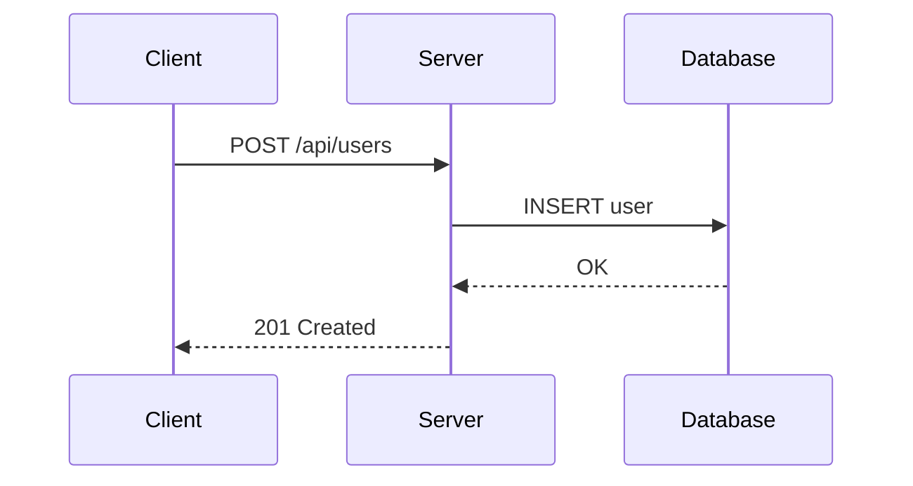

### Activations

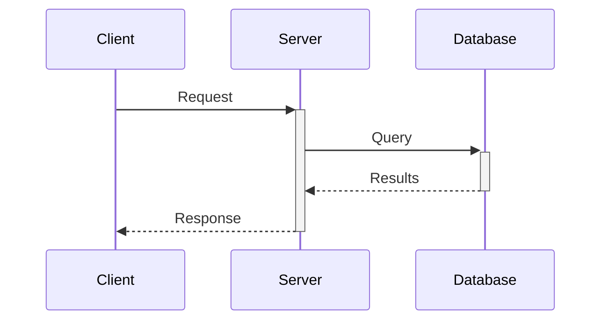

### Notes

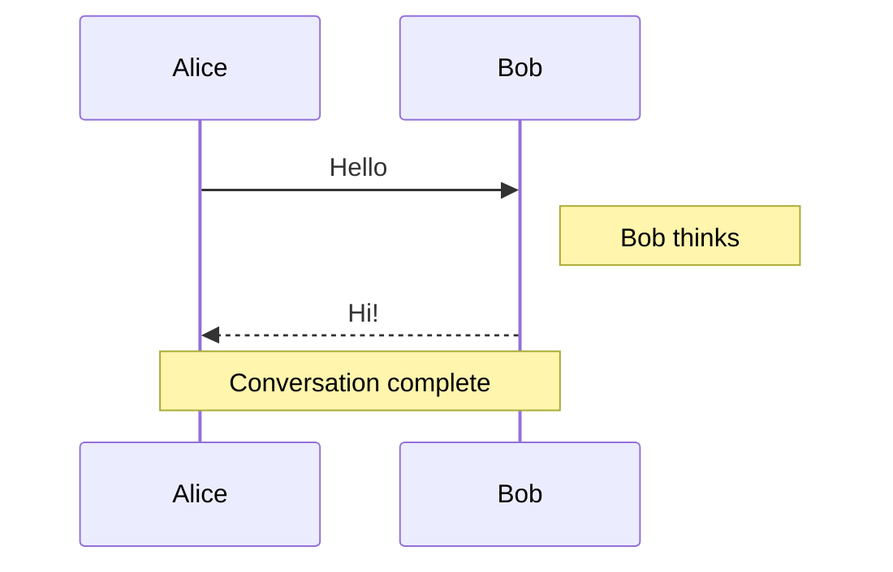

### Loops

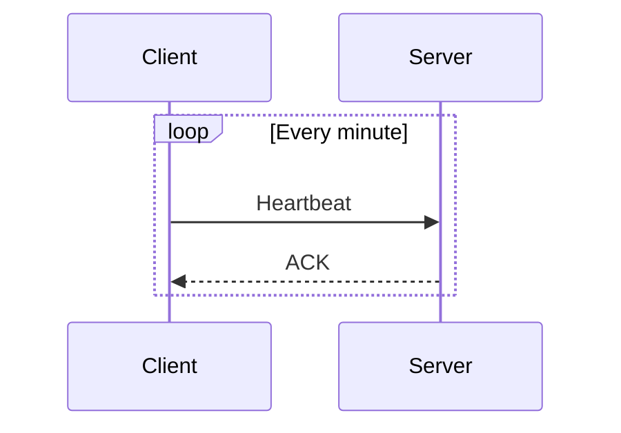

### Alternatives

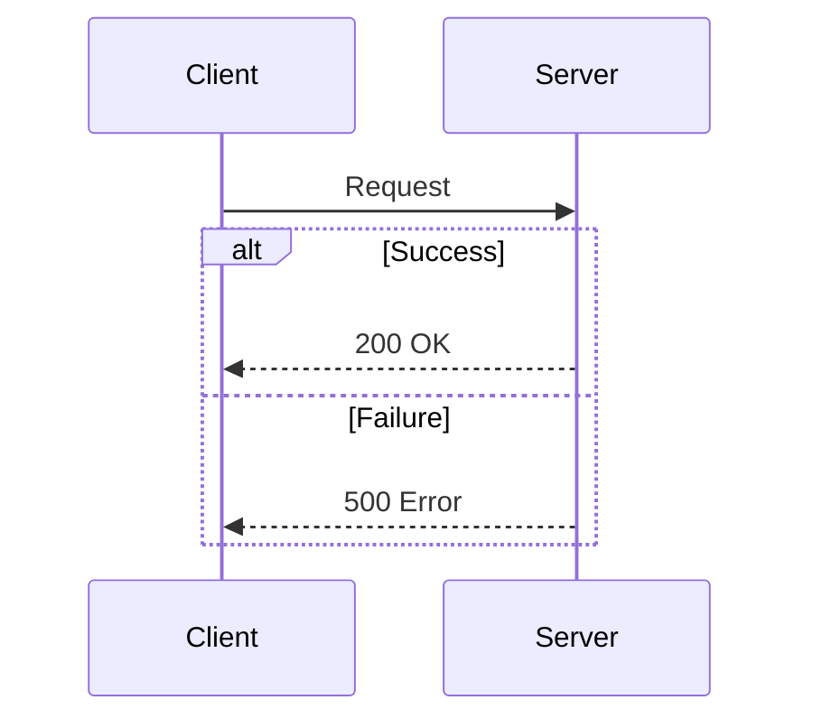

### Optional

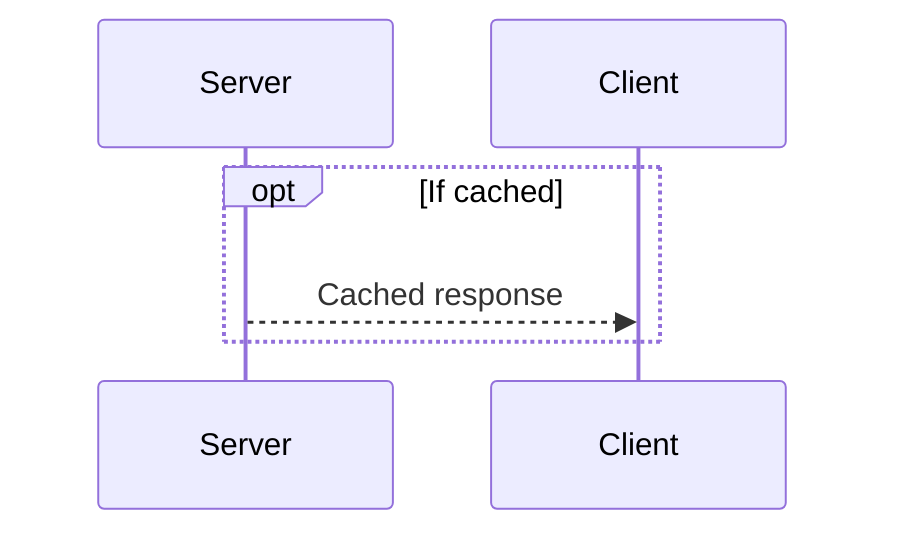

### Parallel

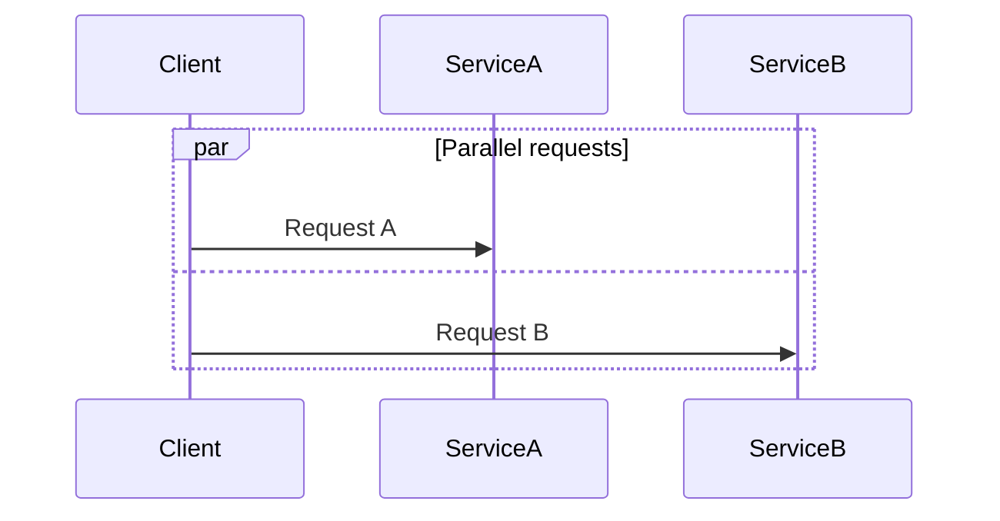

## Class Diagrams

**Header:** `classDiagram`

### Classes with Members

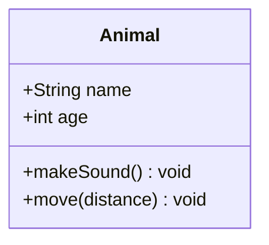

### Visibility Modifiers

| Symbol | Meaning |
|--------|---------|
| `+` | Public |
| `-` | Private |
| `#` | Protected |
| `~` | Package/Internal |

### Relationships

| Syntax | Meaning |
|--------|---------|
| `<\|--` | Inheritance (extends) |
| `*--` | Composition (contains) |
| `o--` | Aggregation (has) |
| `-->` | Association |
| `..>` | Dependency |
| `..\|>` | Realization (implements) |
| `--` | Link (solid) |
| `..` | Link (dashed) |

### Cardinality

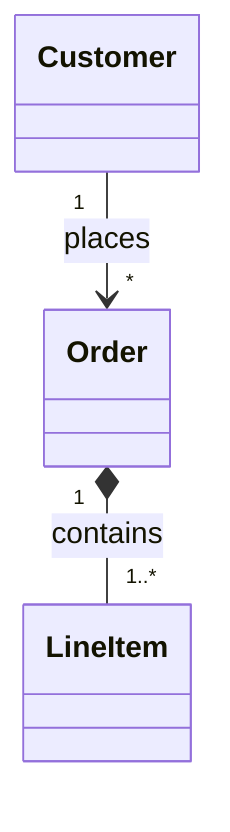

### Full Example

```mermaid
classDiagram
    class Animal {
        <<abstract>>
        +String name
        +int age
        +makeSound()* void
    }

    class Dog {
        +String breed
        +bark() void
    }

    class Cat {
        +bool indoor
        +meow() void
    }

    Animal <|-- Dog
    Animal <|-- Cat
```

### Annotations

```mermaid
classDiagram
    class Service {
        <<interface>>
        +start() void
        +stop() void
    }

    class Logger {
        <<singleton>>
        -instance Logger
        +log(msg) void
    }
```

## ER Diagrams

**Header:** `erDiagram`

### Basic Relationships

```mermaid
erDiagram
    USER ||--o{ ORDER : places
    ORDER ||--|{ LINE_ITEM : contains
    PRODUCT ||--o{ LINE_ITEM : "is in"
```

### Cardinality Notation

| Left | Right | Meaning |
|------|-------|---------|
| `\|\|` | `\|\|` | Exactly one to exactly one |
| `\|\|` | `o\|` | Exactly one to zero or one |
| `\|\|` | `o{` | Exactly one to zero or more |
| `\|\|` | `\|{` | Exactly one to one or more |
| `o\|` | `o\|` | Zero or one to zero or one |
| `o\|` | `o{` | Zero or one to zero or more |
| `o{` | `o{` | Zero or more to zero or more |

### Entity Attributes

```mermaid
erDiagram
    USER {
        int id PK
        string email UK
        string name
        datetime created_at
    }

    ORDER {
        int id PK
        int user_id FK
        decimal total
        date created_at
    }

    USER ||--o{ ORDER : places
```

### Attribute Types

Common attribute markers:
- `PK` - Primary Key
- `FK` - Foreign Key
- `UK` - Unique Key

### Full Example

```mermaid
erDiagram
    CUSTOMER {
        int id PK
        string email UK
        string name
        string phone
    }

    ORDER {
        int id PK
        int customer_id FK
        date order_date
        string status
    }

    PRODUCT {
        int id PK
        string name
        decimal price
        int stock
    }

    LINE_ITEM {
        int id PK
        int order_id FK
        int product_id FK
        int quantity
        decimal unit_price
    }

    CUSTOMER ||--o{ ORDER : places
    ORDER ||--|{ LINE_ITEM : contains
    PRODUCT ||--o{ LINE_ITEM : "included in"
```

## XY Charts

**Header:** `xychart-beta` (vertical charts) or `xychart-beta horizontal` (horizontal charts)

Use XY charts for metrics, trends, comparisons, and simple bar/line visualizations.

**Routing rule:** for data-driven charts (bar, line, funnel, pie), **prefer the `chart` component of `render_ui`** — it inlines the data and renders a polished chart (see [genui.md](./genui.md)). Reach for `xychart-beta` when the chart belongs inside a mermaid diagram set or the data is tiny. Mermaid itself is for **structure**: flows, states, sequences, classes, ER.

### Directives

| Syntax | Meaning |
|--------|---------|
| `title "Chart Title"` | Optional chart title |
| `x-axis [A, B, C]` | Categorical X axis |
| `x-axis "Label" [A, B, C]` | Categorical X axis with title |
| `x-axis 0 --> 100` | Numeric X axis range |
| `x-axis "Label" 0 --> 100` | Numeric X axis with title |
| `y-axis "Label" 0 --> 100` | Numeric Y axis with title/range |
| `bar [10, 20, 30]` | Bar series |
| `line [12, 18, 28]` | Line series |

### Bar Chart

```mermaid
xychart-beta
    title "Monthly Revenue"
    x-axis [Jan, Feb, Mar, Apr]
    y-axis "Revenue ($k)" 0 --> 100
    bar [25, 45, 60, 80]
```

### Line Chart

```mermaid
xychart-beta
    title "Latency Trend"
    x-axis [Mon, Tue, Wed, Thu, Fri]
    y-axis "Latency (ms)" 0 --> 500
    line [320, 280, 240, 210, 180]
```

### Mixed Bar + Line Chart

```mermaid
xychart-beta
    title "Signups vs Activations"
    x-axis [Week 1, Week 2, Week 3, Week 4]
    y-axis "Users" 0 --> 1000
    bar [420, 560, 690, 820]
    line [210, 330, 520, 700]
```

### Horizontal Bar Chart

```mermaid
xychart-beta horizontal
    title "Issue Counts by Severity"
    x-axis [Low, Medium, High, Critical]
    y-axis "Issues" 0 --> 50
    bar [42, 28, 12, 4]
```

## Rendering Behavior

- Wide horizontal diagrams are scaled up to a **minimum readable height** (instead of shrinking to fit), then **scroll horizontally** — faded edges indicate there is more content
- **Click a diagram** (or use its top-right expand button) to open a **fullscreen overlay with zoom and pan controls**
- All mermaid blocks render inline. When a diagram is the **first block of a message**, its own expand button is hidden because the message card's fullscreen control occupies the same top-right spot — click the diagram itself to go fullscreen

## Best Practices

### Choose Orientation by Diagram Size

**IMPORTANT**: The user sees a **4:3 aspect ratio**. Choose the orientation from the diagram's size — do not default to horizontal:

- **Small diagrams** (a handful of nodes): use horizontal layouts — `graph LR`/`RL`, and `direction LR` in state diagrams
- **Large diagrams** (many nodes, long chains): use vertical layouts — `graph TD`/`BT`. They fit the 4:3 viewport far better than a wide horizontal strip that needs scrolling
- **Sequence, class, and ER diagrams** are naturally horizontal; keep them focused so they stay readable

**If a diagram gets long, split it into multiple focused diagrams** instead of emitting one massive diagram. Several smaller diagrams are easier to read, render more reliably, and the UI handles them better.

### Keep Diagrams Focused

One concept per diagram. If a diagram gets complex, split it into multiple diagrams.

### Use Descriptive Labels

```mermaid
graph LR
    A[User submits form] --> B{Validation}
    B -->|Valid| C[Save to database]
    B -->|Invalid| D[Show errors]
```

### Choose the Right Direction

Pick by how much content the diagram has:

**Horizontal — small diagrams (few nodes)**:
- **LR (left-right)**: flows, pipelines, state machines, processes
- **RL (right-left)**: reverse flows (when semantically meaningful)

**Vertical — large diagrams (many nodes, long chains)**:
- **TD (top-down)**: hierarchies, inheritance, org charts, and any diagram that outgrows a 4:3 viewport sideways
- **BT (bottom-top)**: large dependency diagrams that read upward

### Validate Complex Diagrams

Use the `mermaid_validate` tool to check syntax before outputting complex diagrams:

```
mermaid_validate({ code: "graph TD\n  A --> B" })
```

## Troubleshooting

### Common Errors

1. **Missing direction**: Always include direction in flowcharts (`graph TD`, not just `graph`)
2. **Unbalanced brackets**: Ensure all `[`, `(`, `{` are properly closed
3. **Special characters in labels**: Use quotes for labels with special characters
4. **Invalid arrow syntax**: Check the arrow type table above

### Escaping Special Characters

For labels with special characters, wrap in quotes:

```mermaid
graph LR
    A["Label with (parentheses)"] --> B["Label with [brackets]"]
```
